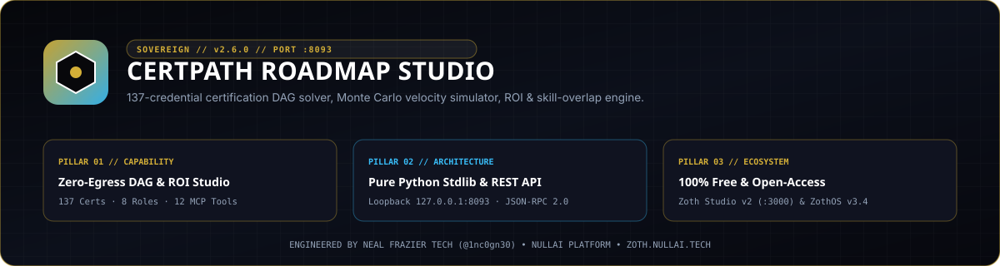

<p align="center">
  
</p>

# CertPath Roadmap Studio (`v2.6.0`)

**Zero-dependency Python 3.9+ IT, cloud, AI, and cybersecurity certification prerequisite DAG solver, career roadmap planner, Monte Carlo study-velocity simulator (`P50/P80/P95`), financial ROI & skill-overlap calculator, and JSON-RPC 2.0 MCP server.**

- **Zoth Studio v2 Route**: [https://zoth.nullai.tech/tools/certpath-roadmap-studio](https://zoth.nullai.tech/tools/certpath-roadmap-studio)
- **Default Loopback Workstation**: `http://127.0.0.1:8093`
- **Catalog**: `137` verified credentials (`0` cycles, `0` dangling prerequisites), `8` career role archetypes, `12` stdio MCP tools
- **Runtime Dependencies**: Zero third-party Python runtime packages (`100% Python stdlib`)
- **License**: MIT (`100% Free & Open-Access`, zero paywalls, zero external CDN egress)

---

## What It Does

`certpath-roadmap-studio` models IT, cloud, DevOps, AI, data, web, and offensive/defensive cybersecurity certifications as a verified directed acyclic graph (DAG). It computes topologically sorted prerequisite chains, identifies downstream credentials unlocked by completing an exam, builds phased career study roadmaps tailored to weekly study budgets, runs stochastic Monte Carlo completion-date simulations (`P50`, `P80`, `P95` with cognitive fatigue warnings), computes financial ROI & pairwise Jaccard skill overlap, and exports roadmaps to Mermaid `flowchart`, ASCII trees, Markdown, CSV, JSON, and Schema.org JSON-LD.

---

## Architecture

```text
src/certpath_roadmap_studio/
├── catalog.py             # Structured 137-cert catalog (providers, exam codes, levels, skills, hours, fees)
├── dag_engine.py          # Bidirectional DAG adjacency, Kahn topological sort, cycle detection, critical path
├── roadmap_planner.py     # 8 built-in career role archetypes & 4-phase milestone planner
├── velocity_simulator.py  # Monte Carlo study-velocity simulator (P50/P80/P95), fatigue & ASCII burndown
├── roi_calculator.py      # Financial ROI (handles $0 free certs honestly), Jaccard overlap & portfolio HHI
├── matrix_exporter.py     # Mermaid flowchart, ASCII tree, Markdown study guide & Schema.org JSON-LD emitters
├── mcp_server.py          # Pure-stdlib JSON-RPC 2.0 stdio MCP server exposing 12 roadmap & ROI tools
├── ui_server.py           # Hardened loopback HTTP API + dual-theme workstation server (127.0.0.1:8093)
└── cli.py                 # Unified CLI entrypoint (`certpath` / `certpath-roadmap-studio`)
```

---

## Quickstart

```bash
git clone https://github.com/1nc0gn30/certpath-roadmap-studio.git
cd certpath-roadmap-studio
python3 -m pip install -e ".[dev]"

# Start the hardened loopback web workstation on http://127.0.0.1:8093
certpath serve --host 127.0.0.1 --port 8093 --no-browser
```

Run directly from a source checkout without installing:

```bash
PYTHONPATH=src python3 -m certpath_roadmap_studio.cli serve --host 127.0.0.1 --port 8093 --no-browser
```

---

## CLI & MCP Usage

### Verified CLI Subcommands

Installed entrypoints: `certpath`, `certpath-roadmap-studio`, and `certpath-roadmap-studio-tui`.

```bash
# View CLI help & version (v2.6.0)
certpath --help
certpath --version

# Search certifications by keyword, provider, level, or category
certpath search kubernetes --json
certpath search --provider AWS --level Intermediate --json

# Resolve topological prerequisite chain or downstream unlocked credentials
certpath prereqs cyber-oscp --json
certpath unlocked cyber-sec-plus --json

# Generate a phased career roadmap for a target role and weekly study budget
certpath plan --role cloud_solutions_architect --hours 15 --format json
certpath plan --target cyber-oscp --hours 12 --format md

# Compare two or more certifications side-by-side
certpath compare cyber-oscp cyber-cissp --json

# Simulate completion timelines via Monte Carlo velocity modeling (P50/P80/P95)
certpath simulate --role soc_analyst --hours 12 --trials 200 --json

# Calculate certification financial ROI and pairwise skill overlap
certpath roi --cert cyber-oscp --json
certpath overlap cyber-sec-plus cyber-cissp --json

# Export Mermaid DAG syntax or ASCII prerequisite tree
certpath mermaid --role penetration_tester
certpath tree cyber-oscp

# Inspect catalog statistics, career roles, and internal self-tests
certpath stats --json
certpath roles --json
certpath test

# Launch the pure-stdlib JSON-RPC 2.0 stdio MCP server
certpath mcp
```

### ZothOS v3.4 CLI & TUI Integration

On ZothOS workstations, binaries are installed in `/usr/local/bin/` with `/opt/certpath-roadmap-studio` runtime backing:

```bash
certpath --status                  # Check installation & :8093 daemon health
certpath --json                    # Deterministic JSON status telemetry
certpath-roadmap-studio-tui --json # Live :8093 probe + 137-cert DAG & ROI benchmark
certpath serve --host 127.0.0.1 --port 8093 --no-browser
```

### Model Context Protocol (MCP) Tools (`12` Tools, Pure Python Stdlib JSON-RPC 2.0)

```json
{
  "mcpServers": {
    "certpath-roadmap-studio": {
      "command": "certpath",
      "args": ["mcp"]
    }
  }
}
```

| MCP Tool | Description |
| :--- | :--- |
| `certpath_search` | Filter certifications by query, provider, difficulty tier, category, or skill |
| `certpath_resolve_prereqs` | Compute ordered prerequisite chains and unlocked downstream credentials |
| `certpath_plan_career` | Build a phased study plan for a career archetype or target certification |
| `certpath_compare` | Compare exam cost, study hours, difficulty, and skills across certifications |
| `certpath_export_dag` | Export roadmap subgraphs as Mermaid `flowchart`, ASCII tree, JSON, or JSON-LD |
| `certpath_roles` | List all 8 built-in career role blueprints and target credential stacks |
| `certpath_catalog_stats` | Return catalog counts, provider distribution, and DAG cycle verification |
| `certpath_simulate_velocity` | Run Monte Carlo study-velocity simulations with `P50/P80/P95` completion dates |
| `certpath_calculate_roi` | Compute net financial ROI, salary delta, and break-even payback months |
| `certpath_skill_overlap` | Measure Jaccard competency overlap and study-hour savings between two certifications |
| `certpath_portfolio_valuation` | Evaluate combined market value, HHI vendor diversity, and salary range |
| `certpath_diagnostics` | Return host runtime health, version, and DAG acyclicity status |

---

## HTTP API Reference (`127.0.0.1:8093`)

Hardened loopback server enforcing strict `Host` & `Origin` allowlists (DNS rebinding & CORS suffix-spoof defense), `Vary: Origin`, security headers (`X-Content-Type-Options: nosniff`, `Referrer-Policy`, loopback `CSP`), `1 MiB` body cap (`413`), strict JSON/numeric validation (`400`, `allow_nan=False`), `HEAD` support, and symlink containment:

| Method | Endpoint | Description |
| :--- | :--- | :--- |
| `GET` / `HEAD` | `/health`, `/api/health`, `/api/diagnostics` | Service health status (`v2.6.0`), catalog size (`137`), and DAG cycle check |
| `GET` | `/api/catalog` | Query and filter certifications (`q`, `provider`, `level`, `category`, `skill`, `limit`) |
| `GET` | `/api/cert/<id>`, `/api/prereqs/<id>`, `/api/unlocked/<id>` | Enriched credential details, topological prerequisites, and unlocked certs |
| `GET` | `/api/stats`, `/api/roles`, `/api/mermaid` | Catalog statistics, 8 career role archetypes, and Mermaid DAG export |
| `GET` / `POST` | `/api/plan` | Generate phased study roadmap (`role`/`target`, `hours`, `max_budget`, `current_certs`) |
| `GET` / `POST` | `/api/compare` | Side-by-side certification comparison |
| `POST` | `/api/search` | Structured JSON certification search |
| `GET` / `POST` | `/api/simulate-velocity` | Monte Carlo study timeline simulation (`P50/P80/P95`) |
| `GET` / `POST` | `/api/roi` | Financial ROI, salary premium, and payback analysis |
| `GET` / `POST` | `/api/overlap` | Pairwise certification Jaccard skill-overlap calculation |
| `GET` / `POST` | `/api/valuation` | Multi-certification portfolio valuation |
| `GET` / `HEAD` | `/terms`, `/privacy`, `/support` | MIT terms, zero-egress privacy policy, and community support |

---

## Testing & Verification

```bash
# Run the full pytest test suite (131+ tests incl. security & MCP fuzzing)
PYTHONPATH=src python3 -m pytest -v tests

# Run internal CLI self-verification
certpath test

# Scan repository for secrets
gitleaks detect --source . --no-banner --redact
```

---

## Support

CertPath Roadmap Studio is 100% free and open-source software with zero paywalls or feature gates. Optional community support:
- [Buy Us a Coffee (Stripe)](https://buy.stripe.com/3cIfZg27PdKo2D64Ocfw40X)
- Solana Tip Address: `GG2eQbVh8ut1BK6j1A2tz7pSySdLpD38BgyEhGcxdXoK` (`solana:GG2eQbVh8ut1BK6j1A2tz7pSySdLpD38BgyEhGcxdXoK`)

## License

MIT License — Engineered by **Neal Frazier Tech** ([@1nc0gn30](https://github.com/1nc0gn30)) • [NullAI Platform](https://nullai.tech). See [LICENSE](LICENSE) for full text.
