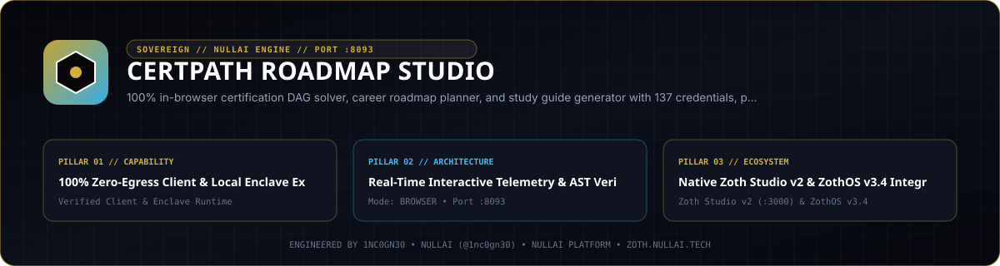

<p align="center">
  
</p>

# CertPath Roadmap Studio

**Zero-dependency Python 3.9+ IT, cloud, and cybersecurity certification prerequisite DAG solver, career roadmap planner, Monte Carlo study-velocity simulator, financial ROI & skill-overlap calculator, and MCP server.**

- **Zoth Studio v2 Dossier**: [https://zoth.nullai.tech/tools/certpath-roadmap-studio](https://zoth.nullai.tech/tools/certpath-roadmap-studio)
- **Default Loopback Endpoint**: `http://127.0.0.1:8093`
- **Runtime Dependencies**: Zero external Python runtime packages (100% Python `stdlib`)
- **License**: MIT (100% free and open-source)

---

## Overview

`certpath-roadmap-studio` models IT, cloud, DevOps, AI, and offensive/defensive security certifications as a verified directed acyclic graph (DAG). It computes topologically sorted prerequisite chains, identifies downstream credentials unlocked by completing an exam, generates phased career study roadmaps tailored to weekly study budgets, runs Monte Carlo completion-date simulations, calculates financial return on investment (exam cost + study-hour opportunity cost vs. salary uplift), and exports roadmaps to Mermaid `flowchart`, ASCII trees, Markdown, and JSON-LD.

---

## Architecture

```text
src/certpath_roadmap_studio/
├── catalog.py             # Structured certification catalog (providers, exam codes, levels, skills, hours)
├── dag_engine.py          # Topological sort, transitive prerequisite closure, cycle detector & unlock graph
├── roadmap_planner.py     # Role-based phased career planner (Cloud Architect, Red Team, DevSecOps, ML Eng, etc.)
├── velocity_simulator.py  # Monte Carlo study-velocity and completion-window simulator
├── roi_calculator.py      # Financial ROI, payback period, Jaccard skill overlap & portfolio valuation engine
├── matrix_exporter.py     # Mermaid flowchart, ASCII tree, Markdown study guide & JSON-LD emitters
├── mcp_server.py          # JSON-RPC 2.0 stdio MCP server exposing 12 roadmap & ROI tools
├── ui_server.py           # Loopback HTTP API + browser workstation server (127.0.0.1:8093)
└── cli.py                 # Unified CLI entrypoint (`certpath` / `certpath-roadmap-studio`)
```

---

## Quickstart

```bash
git clone https://github.com/1nc0gn30/certpath-roadmap-studio.git
cd certpath-roadmap-studio
python3 -m pip install -e ".[dev]"

# Start the loopback web workstation on http://127.0.0.1:8093
certpath serve --host 127.0.0.1 --port 8093
```

Run directly from a source checkout without installing:

```bash
PYTHONPATH=src python3 -m certpath_roadmap_studio.cli serve --port 8093
```

---

## CLI & MCP Usage

### CLI Subcommands

Installed entrypoints: `certpath`, `certpath-roadmap-studio`, and `certpath-studio`.

```bash
# View CLI help
certpath --help

# Search certifications by keyword, provider, level, or category
certpath search --query "kubernetes" --format json

# Resolve topological prerequisite chain or downstream unlocked credentials
certpath prereqs aws-solutions-architect-pro
certpath unlocked comptia-security-plus

# Generate a phased career roadmap for a target role and weekly study budget
certpath plan --role cloud-architect --hours 10 --format json

# Compare two or more certifications side-by-side
certpath compare oscp cissp

# Simulate completion timelines via Monte Carlo velocity modeling
certpath simulate --role cybersecurity-analyst --hours 12

# Calculate certification financial ROI and skill overlap
certpath roi aws-solutions-architect-associate
certpath overlap comptia-security-plus cissp

# Export Mermaid DAG syntax or ASCII prerequisite tree
certpath mermaid --category "Cyber Security"
certpath tree oscp

# Inspect catalog statistics and DAG acyclicity
certpath stats
certpath roles

# Launch the stdio MCP server
certpath mcp
```

### ZothOS v3.4.0 CLI Integration

On ZothOS v3.4.0 workstations, `certpath` is symlinked in `/usr/local/bin/certpath`:

```bash
certpath stats
certpath web                 # Starts http://127.0.0.1:8093
certpath desktop             # Launches the Electron workstation shell
```

### Model Context Protocol (MCP) Tools

```json
{
  "mcpServers": {
    "certpath-roadmap-studio": {
      "command": "certpath",
      "args": ["mcp"]
    }
  }
}
```

| MCP Tool | Description |
| :--- | :--- |
| `certpath_search` | Filter certifications by query, provider, difficulty tier, category, or skill |
| `certpath_resolve_prereqs` | Compute ordered prerequisite chains and unlocked downstream credentials |
| `certpath_plan_career` | Build a phased study plan for a career archetype or target certification set |
| `certpath_compare` | Compare exam cost, study hours, difficulty, and skills across certifications |
| `certpath_export_dag` | Export roadmap subgraphs as Mermaid `flowchart`, ASCII tree, Markdown, or JSON-LD |
| `certpath_roles` | List built-in career role blueprints and target credential stacks |
| `certpath_catalog_stats` | Return catalog counts, provider distribution, and DAG cycle verification |
| `certpath_simulate_velocity` | Run Monte Carlo study-velocity simulations with P10/P50/P90 completion dates |
| `certpath_calculate_roi` | Compute net financial ROI, salary delta, and break-even payback months |
| `certpath_skill_overlap` | Measure competency overlap and study-hour savings between two certifications |
| `certpath_portfolio_valuation` | Evaluate combined market value and domain coverage of an existing cert stack |
| `certpath_diagnostics` | Return host runtime health and DAG verification status |

---

## HTTP API Reference

When running on `http://127.0.0.1:8093`:

| Method | Endpoint | Description |
| :--- | :--- | :--- |
| `GET` | `/health`, `/api/health`, `/api/diagnostics` | Service health status, catalog size, and DAG cycle check |
| `GET` | `/api/catalog` | Query and filter certifications (`q`, `provider`, `level`, `category`) |
| `GET` | `/api/stats` | Catalog summary statistics and provider counts |
| `GET` | `/api/roles` | Career role templates |
| `GET` | `/api/mermaid` | Export Mermaid DAG diagram (`category`, `direction`) |
| `GET` / `POST` | `/api/plan` | Generate phased study roadmap |
| `GET` / `POST` | `/api/compare` | Side-by-side certification comparison |
| `POST` | `/api/search` | Structured certification search |
| `GET` / `POST` | `/api/simulate-velocity` | Monte Carlo study timeline simulation |
| `GET` / `POST` | `/api/roi` | Financial ROI and payback analysis |
| `GET` / `POST` | `/api/overlap` | Pairwise certification skill-transfer calculation |
| `GET` / `POST` | `/api/valuation` | Multi-certification portfolio valuation |

---

## Testing & Verification

```bash
# Run the pytest test suite
python3 -m pytest -q

# Run internal CLI self-verification
certpath test

# Scan repository with gitleaks
gitleaks detect --source . --no-banner --redact
```

---

## Support

CertPath Roadmap Studio is 100% free and open-source software. Optional community support is available via [Buy Us a Coffee (Stripe)](https://buy.stripe.com/3cIfZg27PdKo2D64Ocfw40X).

## License

MIT License — Copyright (c) 2026 [1nc0gn30](https://1nc0gn30.si) (`@1nc0gn30`) & [NullAI](https://nullai.tech). See [LICENSE](LICENSE) for full text.
